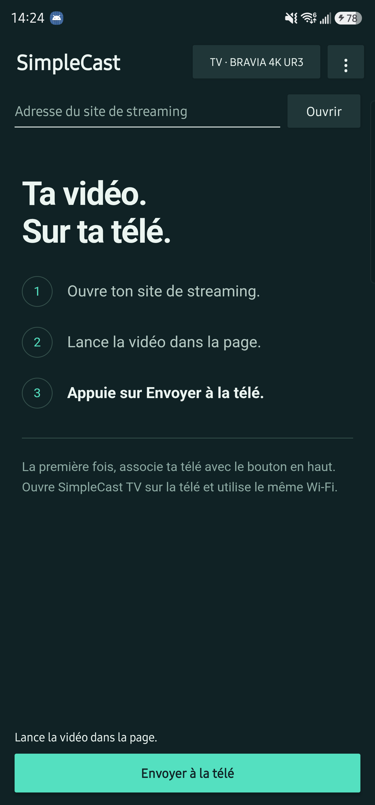

# SimpleCast

Cast compatible video streams to your TV, even when the website's player has no Cast button or disables casting.

A lightweight Android app that finds video players on web pages and sends their streams to Chromecast or SimpleCast TV. No direct video URL required, no app ads, and no added analytics.

- Detects players in pages and iframes, including MP4, WebM, HLS, and DASH streams.
- Prioritizes playing players, associated streams, and recently detected URLs.
- Blocks popups, unsolicited cross-site navigation, and selected advertising scripts.
- Supports direct playback on Android TV and Google TV through SimpleCast TV.



## Install

| APK | Version | Device |
| --- | --- | --- |
| [SimpleCast.apk](dist/SimpleCast.apk) | 0.3.1 | Android phone, Android 8.0+ |
| [SimpleCast-TV.apk](dist/SimpleCast-TV.apk) | 0.1.1 | Android TV or Google TV, Android 8.0+ |

Keep both devices on the same local network. The phone app requires an up-to-date Android System WebView; standard Chromecast playback also requires Google Play Services.

## Use

1. Open a video page in the phone app, or share its URL from your browser.
2. Start the video, then tap **Scanner les lecteurs** or **Lecteurs détectés**.
3. Choose the playing player and its stream.

**Android TV / Google TV:** Install and open SimpleCast TV on the TV. On the phone, tap **TV**, select the receiver, and enter its displayed code. After choosing a stream, tap **Lire sur SimpleCast TV**. The TV downloads the video directly, without relaying it through the phone. Once playback starts, you can turn off the phone's screen. Keep the TV app open. To switch receivers or reconnect after reopening it, disconnect through **TV**, then select the receiver again.

**Chromecast:** Tap **Caster** and choose your Chromecast. The optional **Relayer par le téléphone** setting is off by default; enabling it routes video through the phone and uses more battery.

A three-player demo is available under **? → Démonstration**.

## Limitations

DRM, WebRTC, and transcoding are not supported. Playback depends on the server and device codecs. SimpleCast TV supports additional stream types and website request information that standard Cast cannot always handle. Browser cookies and account authorization headers are not transferred. Live links and temporary stream tokens can expire; reopen the player and scan again if needed. The popup filter is not a full ad blocker.

## Build

Requires JDK 17+ and Android SDK 36. Generate both release APKs in `dist/`, with unit tests and Android Lint checks:

```sh
sh ./gradlew packageRelease
```

On Windows, use `gradlew.bat packageRelease`. Builds use the local development signing key. See [development notes](docs/DEVELOPMENT.md) for project structure and additional tests, and [the changelog](CHANGELOG.md) for recent changes.

## License

[MIT](LICENSE). Third-party components retain their own licenses, including [NanoHTTPD](app/src/main/assets/licenses/nanohttpd.txt) and [AndroidX Media3](tv/src/main/assets/licenses/media3.txt).

**Note: The codebase and user interface are in French.**
